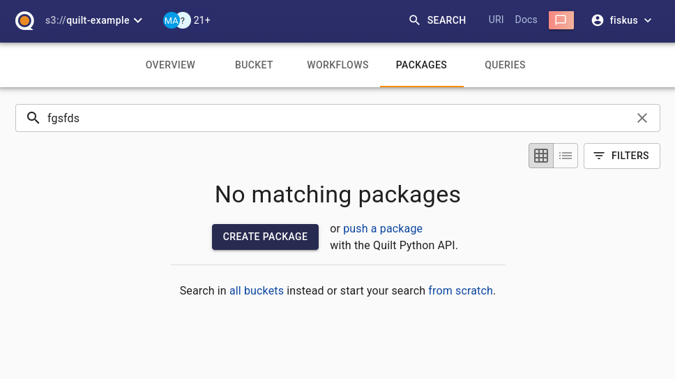
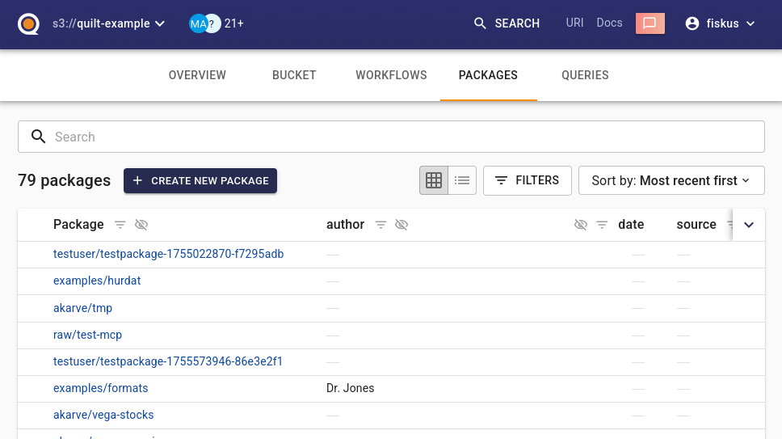
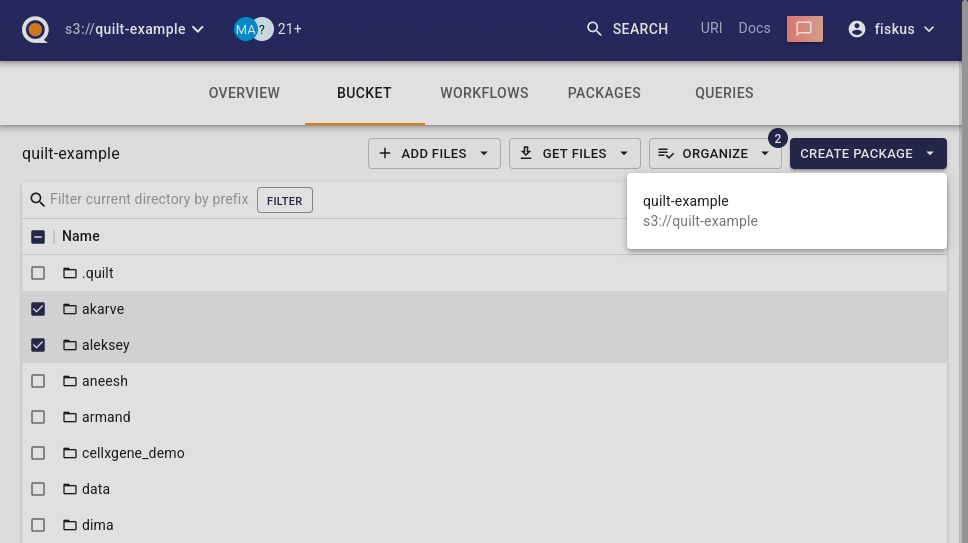
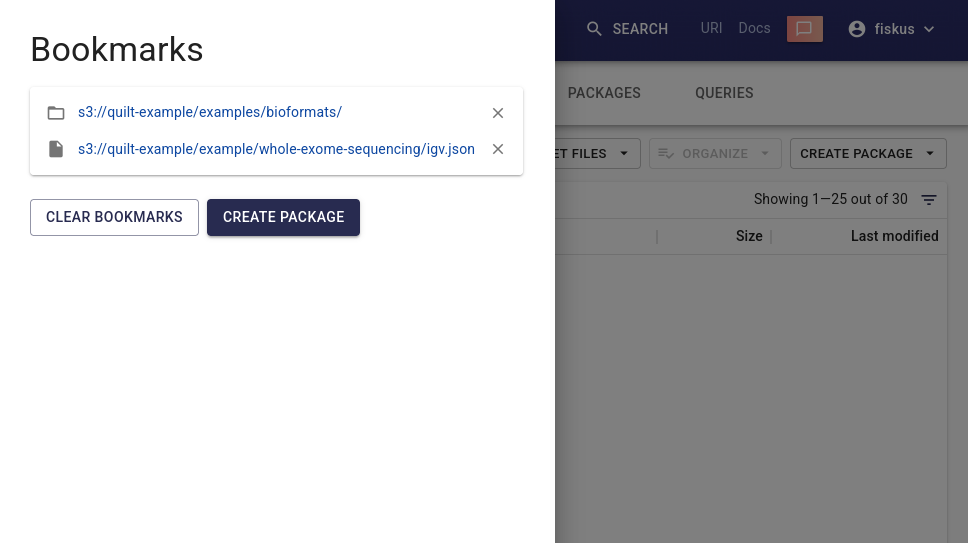
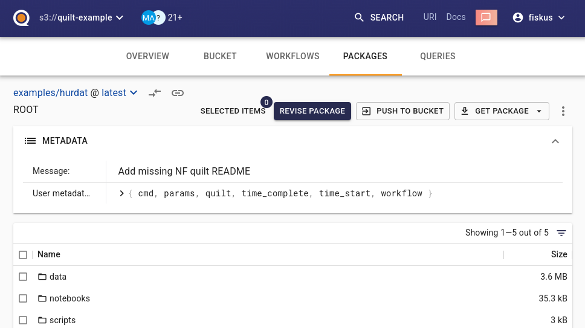
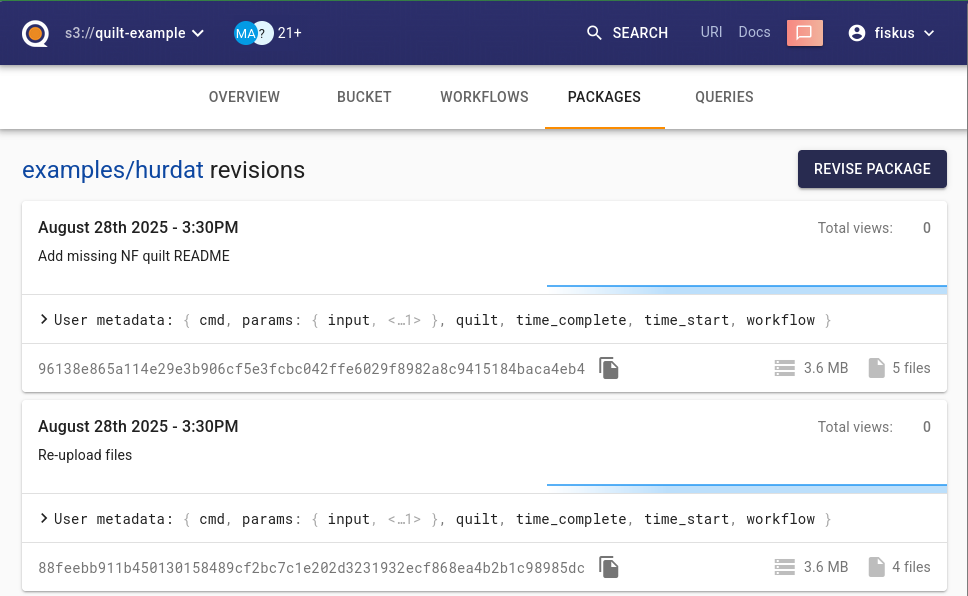

# Catalog Package Dialog

**All dialogs require:** Destination bucket

## New Package From Scratch

### Empty packages list
"No matching packages" message with create button

https://nightly.quilttest.com/b/quilt-example/packages/?q=fgsfds



**Input:**
- Destination bucket

### Package list directory
From embedded search page view within packages list

https://nightly.quilttest.com/b/quilt-example/packages/



**Input:**
- Destination bucket

## New Package With Pre-Selected Content

### From selected S3 files in a Bucket
Create package with selected files/directories (directories resolve to file lists)

https://nightly.quilttest.com/b/quilt-example/tree/



**Input:**
- Destination bucket
- List of selected S3 files or directories

**Test files tree:**
```
bucket/
├── root-file.txt
├── test/ with / # complex ! /path.txt
└── nested/
    ├── level1-file.txt
    └── deep/
        ├── level2-file.txt
        ├── level3-file.txt
        └── deeper/
            └── level4-file.txt
```

### From Athena search results
Create package with found search entries

**Input:**
- Destination bucket
- List of files from Athena search results (used as is, without additional resolving work)

*Note: Athena search results rows that are not valid S3 files are discarded (user confirmation required in such cases)*

### From Bookmarks
Create package with bookmarked files (directories resolve to contained files)



**Input:**
- Destination bucket
- List of bookmarked S3 files or directories

The same test cases as in "From selected S3 files in a Bucket"

## Revise Existing Package

*Note: If users enter the name of an existing package, every package dialog from previous sections becomes "Revise existing package" dialog*

### Package page
From package directory or root ("/") directory with pre-uploaded manifest

https://nightly.quilttest.com/b/quilt-example/packages/examples/hurdat



**Input:**
- Source: bucket, name and hash of the current package
- Destination: bucket and name

### Package `/add` URL
`/b/<bucket>/packages/<name>/add` opens the revise dialog on the package page. It adds no files: the query string is ignored.

https://nightly.quilttest.com/b/quilt-example/packages/examples/hurdat/add

**Input:**
- Source: bucket, name and hash of the current package
- Destination: bucket and name

**Test:** open https://nightly.quilttest.com/b/quilt-example/packages/examples/hurdat/add?README.md=s3://quilt-example/README.md. The dialog opens with the package's current entries only; nothing from the query string is added.

### From the file editor
Saving a file in the file editor opens the revise dialog with that file at its logical key.

- **Edit:** on a file page of the package's latest revision, click **Edit**, change the file and save it.
- **Create file:** choose **Create file** in the package's revision menu, enter a name, write the file and save it.

**Input:**
- Source: bucket, name and hash of the current package
- Destination: bucket and name
- The saved file: logical key → its new S3 version

### Package revisions page
Revise existing package (similar to package view page)

https://nightly.quilttest.com/b/quilt-example/packages/examples/hurdat/revisions



**Input:**
- Source: bucket, name
- Destination: bucket

## Copy Package

### Package page
Copy the contents of the package to the successor bucket without ability to modify the files

**Input:**
- Source: current package (bucket, name, hash)
- Destination: selected bucket and current package name
